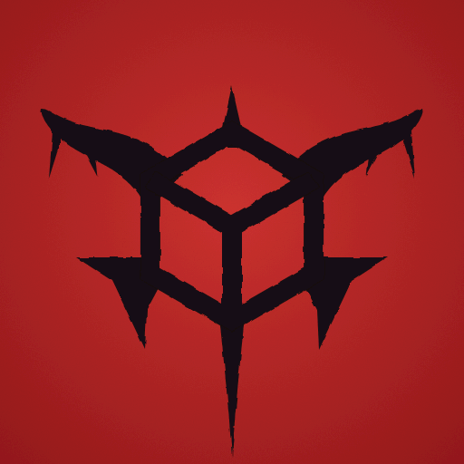

# CubeEvil4


[](https://discord.gg/AB3WVBqD5G)
[](https://paypal.me/andiweli)

**[STATUS](#status) | [HOW TO USE](#how-to-use) | [DISCORD](https://discord.gg/AB3WVBqD5G) | [ALPHA RELEASE](https://github.com/Andiweli/CubeEvil4-Android/releases)**

**CubeEvil4** is an unofficial, native Android port of the GameCube debug build of Resident Evil 4
(`G4BE08`, the "Nov 25 2004" prototype on two discs). It does not recreate the game: the app runs
the original game code, compiled from the complete decompilation in this repository for ARM. It is
not affiliated with or endorsed by Capcom, Nintendo or CRI Middleware, and it contains no game
data: you need your own images of both debug discs.

<p align="center"></p>

## What the app does

- The whole game code (`src/`, all 114 REL modules) runs natively, as ARM32 (`armeabi-v7a`) and
  ARM64 (`arm64-v8a`) in one APK. Only the GameCube platform layer is replaced (graphics, video
  timing, OS, disc, controller, sound, memory card, ARAM, movies).
- Graphics: the game's own GX commands are translated to OpenGL ES 3 (logos, menus, rooms,
  characters, effects, subtitles), at 1080p and above, with optional anti-aliasing,
  anisotropic filtering and depth of field.
- Sound: the original SDK sound libraries with an emulated DSP; movies through the original CRI
  middleware with picture and ADX sound.
- Memory card as a file inside the app, with `.gci` import and export (Dolphin, GameCube).
- Controller like the GameCube pad, with vibration. SELECT opens the app menu (graphics,
  memory card, error report); holding SELECT opens the game's own debug menu.
- Android 6.0 or later, OpenGL ES 3.0.

## Status

Work in progress.  
Tested on the following devices:
- Retroid Pocket Flip 2 (Android 13)
- POCO X7 Pro (Android 16)

32 and 64 bit: title, opening movie, the police car ride and the start of the village (stage 1-1); saving and loading on the
device in 32 bit and in the PC check in 64 bit. On the PC, a comparison run plays the 32- and
64-bit core with the same input through these parts and finds every frame and every compared
picture identical. Later rooms have not been played through yet; that is the next step (a tour
of many rooms). Progress, test results and every patch are recorded in
`port/docs/whole-program-status.md` (German).

> [!IMPORTANT]
> The game is the debug build, and its debug menu is still switched on for the test runs: holding
SELECT opens it (rooms are chosen there). Use the debug menu with care: it is
the developers' internal tool from 2004, and some of its options can hang or crash the game or
leave the game (and a save made afterwards) in an odd state. Such problems come from the debug build itself, not from the port.

## How to use?

**You need**

- An Android device with Android 6.0 or later, OpenGL ES 3.0 and a 32- or 64-bit ARM processor.
- A game controller (built in, USB or Bluetooth). There are no touch controls at the moment. 
- Your own disc images (ISO or GCM) of **both** discs of the GameCube debug build from
  November 25, 2004 (`G4BE08`), and enough free storage to import them.

**First start**

1. Install the APK and open **CubeEvil4**.
2. Choose **Import Disc 1** and **Import Disc 2** and pick the image files. The game starts only
   once both discs are imported.
3. Choose **Start game**. If your controller's face buttons are labelled the other way round,
   tick "Swap A/B and X/Y" on the start screen.

**SELECT button**

- **Press SELECT:** the app menu: graphics (resolution, anti-aliasing, texture filter, 16:9 or
  4:3 picture, FPS display, depth of field), memory card (export and import saves as `.gci` for
  Dolphin and the GameCube) and the error log (send or save a report). B returns to the game.
- **Hold SELECT for a second:** the game's own debug menu (use with care, see Status: some of
  its options can break the game in ways the port has nothing to do with).

**Buttons**

| Controller | GameCube | In the game |
|---|---|---|
| A, B, X, Y | A, B, X, Y | by their labels |
| Left stick | Control stick | move |
| Right stick | C stick | |
| D-pad | D-pad | |
| START | START | |
| R2 | R | ready weapon |
| L2 | L | knife |
| R1 | Z | map |
| SELECT | – | app menu (hold: debug menu) |

The controller (or the device) vibrates where the game uses the rumble, if it can.

## Building the app

No disc images or game files ever go into the repository.

1. Build the game core for Android (Linux or WSL2, Android NDK r28c):
   `port/tools/whole_build_android.sh` (on Windows,
   `powershell -ExecutionPolicy Bypass -File .\port\scripts\test-core-app.ps1 -SkipApk -SkipDevice`
   does the same through WSL). The libraries land in
   `port/android-decomp/app/src/core/jniLibs/` (not in git).
2. Open `port/android-decomp` in Android Studio, choose the build variant **coreRelease** and
   build a signed APK (Build → Generate Signed App Bundle or APK).
3. Install the APK, start **CubeEvil4** and import Disc 1 and Disc 2 (ISO or GCM of the debug
   build).

`port/scripts/test-core-app.ps1` builds, installs and tests the app on a device in one go;
`port/tools/whole_build.sh` and `port/tools/whole_r100_check.sh` check the core on Linux.

## Where the port lives

- `port/whole/` builds the whole game for the host and for Android: the rewrites, replacement
  headers and patches applied to the unchanged `src/` and `include/`, and the platform layer
  (`port/whole/runtime/`).
- `port/android-decomp/` is the Android app (Gradle project, Android Studio).
- `port/tools/` has the build and check scripts, `port/docs/` the plans and the status file.

## The decompilation

The port is built on a complete decompilation of the debug build. The debug build shipped with
`Bio4.sym` symbol files that name every function, and that is what made a full decompilation
possible.

Building the repository gives back the exact original files: `main.dol` and all 114 REL overlays,
checked against `config/G4BE08/build.sha1` on every build. The source is about 570,000 lines of C and
C++ in `src/` and 44,000 lines of headers in `include/`, with no assembly files.

The code is built with the compilers the original was built with:

| Code | Compiler |
|---|---|
| The game | SN Systems ProDG 3.9.3, GCC 2.95.3 "SN BUILD v1.79", built from SN's GPL source release |
| CRI middleware (`adx_*`, `sfd_*`, `mpv_*` and the rest in `src/lib/`) | Metrowerks CodeWarrior 2.4.7, which CRI shipped the libraries with |
| Nintendo SDK (`OS*`, `GX*` and the rest in `src/lib/`) | Metrowerks CodeWarrior GC/1.2.5n, sources from [dolsdk2004](https://github.com/doldecomp/dolsdk2004) |

There are no game assets in this repository. To build it you need your own images of the debug
discs. Disc 1 has `main.dol` and most of the RELs, disc 2 has the four RELs for the island stages.

This repository is a fork of the decompilation by
[adonis-singh](https://github.com/adonis-singh/re4); its build and research documentation follows.
The CC0 terms in [LICENSE](LICENSE) apply only to the project's own tools, configuration and
documentation, not to Capcom's game code or Nintendo/CRI SDK and middleware code. The Android
port does not change those ownership or licensing limitations.

### Building the original files

You need Linux, Python 3 and [ninja](https://ninja-build.org/). The first configure run downloads
decomp-toolkit, objdiff, wibo and the CodeWarrior compilers. The SN GCC is built once from SN's
source:

```sh
# 1. build the SN compiler once (needs SN's GPL source release, see tools/sn-gcc/build.sh)
SN_GCC_SRC=/path/to/NGC_GNU_SRC/NGC tools/sn-gcc/build.sh

# 2. copy in your disc images
cp re4_debug_disc1.iso re4_debug_disc2.gcm orig/G4BE08/

# 3. build
python3 configure.py && ninja
```

`ninja` finishes with a progress report that should say 100% matched and linked. To check the result,
`build/tools/dtk shasum -c config/G4BE08/build.sha1` should print one `OK` per file, 115 in all.

When working on one unit, `python3 tools/bytecmp.py game/foo` compares its object file with the
original, and `python3 tools/fdiff.py game/foo <symbol>` shows one function side by side.

### What's where

- `src/game/` is the game itself. `src/em*/` are the enemies, `src/wep*/` the weapons, `src/pl*/` the
  player characters and `src/st*/` the rooms, one REL per room. `src/t_*/`, `src/Tools/` and
  `src/tools/` are the in-game debug editors, `src/Sscrn/` the menu screens and `src/lib/` the SDK,
  CRI and runtime libraries.
- `include/` has the headers, including the reconstructed structs.
- `config/G4BE08/` has the unit lists, symbols, splits, linker scripts and per-REL data.
- `tools/` has the build scripts, the compare tools, the SN compiler build and the research kit.
  `tools/motion_export.py` exports the game's animations to glTF and BVH, see `tools/motion/README.md`.
- `docs/overview.md` is a guide to how the engine fits together. `docs/matching.md` explains how the
  matching was done and `docs/unit-notes.md` has notes per unit. `docs/research/` is the detailed log.

### How close is the match

Every unit compiles to the original bytes with the original compilers. In some places the compiler
only picks the same registers or instruction order as the original if the code is written in a
particular way, and no natural way of writing it was found. Those spots are marked with a
`// COMPILER-DIFF:` comment, 526 of them at the moment. Most are a dead test, an empty `asm("")` or a
`register T x asm("rN")` declaration. None of them puts an instruction into the output, and
`python3 tools/asmcheck.py --all` checks that. `docs/matching.md` explains the reason behind each
kind. Getting this number down is ongoing work.

Almost all the assembly left is code the original developers also wrote in assembly, because their
compilers couldn't express it in C. That's the paired-single math and matrix routines, the GQR setup,
an exception handler, the cache and SPR code in the CRI video decoder, and eight startup, debugger and
decompression units that were assembly to begin with. In the game code `asmcheck.py` counts 231
instructions of it, with the eight assembly units counted separately. The exceptions are in the CRI
libraries: one small block in `dct_ac` that works around a difference between our build of
CodeWarrior and Capcom's, and 28 register pins that emit nothing. `docs/naming.md` lists all of it.

### Names

Function names are Capcom's own, from `Bio4.sym`. They are C++ mangled names, which is why the game
code is C++ and the SDK, CRI and C library code is C. File names and the split into units come from
the `D:/Bio4/Prog/<file>.cpp` paths the asserts left in the binaries.

Struct and field names come from three places. Most are Capcom's, taken from the debug information in
the PS2 debug build and matched to the GameCube layouts with `tools/ps2sym.py`. Some are ours, named
from how the code uses them. The rest are placeholders like `x1C`, named after their offset because
their meaning isn't known yet. Capcom's names keep Capcom's spelling, so the naming style is mixed on
purpose. Constants use the PS2 build's enums. `docs/naming.md` has the details.

### Contributing

See `CONTRIBUTING.md` for the build, the three checks a change has to pass and the rules. The main rule
is that the output bytes never change.

## Support

If you enjoy this project and would like to support my work, you can make a small contribution via PayPal.

Your support helps me spend more time maintaining existing projects, fixing bugs, improving compatibility, and working on new features.

[](https://paypal.me/andiweli)

[](https://discord.gg/AB3WVBqD5G)

Thank you for your support!

## Legal

CubeEvil4 is an unofficial fan project, not affiliated with or endorsed by Capcom, Nintendo or CRI
Middleware. Resident Evil is a trademark of Capcom; it is named here only to say which game the
port runs. The reconstructed game and SDK source is the property of Capcom, Nintendo and CRI
Middleware and is published for research and preservation only. No game data is included or
distributed; you need your own discs. The build scripts, tools, configuration and documentation
written for this project are released under CC0, see `LICENSE`.
